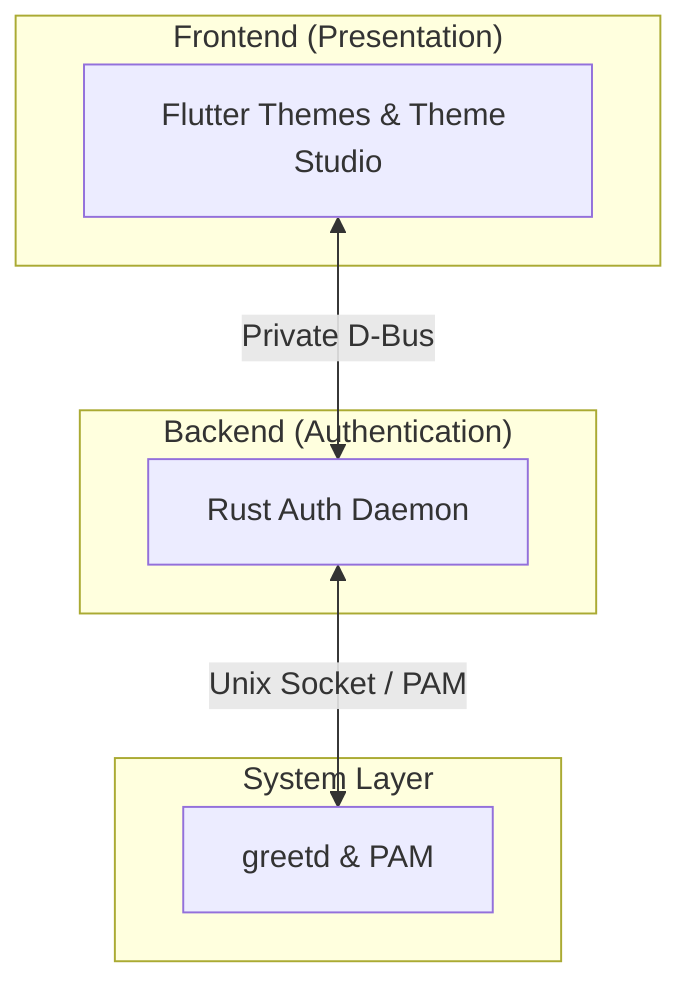

<p align="center">
  
</p>

<h1 align="center">Akari</h1>

<p align="center">
  <em>A themeable Linux greeter.</em>
</p>

<p align="center">
  <a href="https://anfsity.github.io/Akari/">Documentation</a> ·
  <a href="https://anfsity.github.io/Akari/zh-cn/">中文文档</a> ·
  <a href="docs/getting-started/quick-start.md">Quick Start</a> ·
  <a href="docs/reference/cli.md">CLI Reference</a> ·
  <a href="docs/architecture/overview.md">Architecture</a>
</p>

---

**Akari** stands for **A**uthentication **K**it for **A**rtistic, **R**esponsive **I**nterfaces.

Build your login screen with custom Flutter components, backgrounds, and animations. The Rust backend handles authentication through `greetd` and `PAM`, keeping theme development focused entirely on presentation.

> Named after Akari Hankui (半杭朱理) from *Asobi no Kankei*, a character I love.

## Features

- **Custom Themes**: Compose Flutter widgets using the Theme SDK with typed login state, session selection, and power actions. Each theme owns its components, visual tokens, and assets.
- **Scenes and Animations**: Describe layout hierarchy, visibility rules, backgrounds, and motion in scene JSON. The selected theme and generated scene code are compiled directly into the executable.
- **Theme Studio**: A visual workspace to inspect and adjust scenes with an interactive canvas, layer hierarchy, property inspector, and undo/redo—supporting hot reload during development.
- **Artistic Visuals & Shaders**: Harness Flutter's graphics pipeline, including custom Canvas painters and fragment shaders (such as procedural rain, glass refraction, and light streaks).
- **Multi-Display & HiDPI**: Synchronize accounts, session choices, and authentication state across all connected monitors, adapting seamlessly to per-monitor resolutions and display scales.
- **Privilege Separation**: The Rust backend isolates PAM and `greetd` interactions over a private D-Bus interface, ensuring themes operate safely in presentation space.

## Architecture



## Quick Start

### Prerequisites

Development requires Linux, FVM, Rust/Cargo, Flutter Linux build dependencies, and D-Bus utilities. Follow the [environment setup guide](docs/getting-started/installation.md) to prepare your system.

### Bootstrap Toolchain

```sh
git clone https://github.com/anfsity/Akari.git
cd Akari
bash scripts/bootstrap-toolchain.sh
```

### Try in 30 Seconds

Run an isolated, resizable preview demonstrating authentication journeys (such as face unlock success and password fallback) without root privileges or a background daemon:

```sh
fvm dart run tool/akari.dart preview --theme themes/fallback
```

Use `--scenario` to test specific journeys, `--theme themes/default` to try the default theme, or follow the [theme development guide](docs/guides/themes.md) to create your own.

## The Akari CLI

Akari includes a unified CLI (`tool/akari.dart`) that manages the complete development, verification, and deployment lifecycle.

You can invoke commands directly with `fvm dart run tool/akari.dart <command>`, or install the lightweight shell launcher and autocompletion:

```sh
fvm dart run tool/akari.dart install cli --shell zsh   # or bash
```

Once installed, use `akari <command>` directly from anywhere in the repository:

| Command | Description |
| :--- | :--- |
| **`akari preview`** | Open an automated, standalone preview window (`--scenario`, `--theme`) |
| **`akari run`** | Run the greeter with a mock backend on an isolated D-Bus session |
| **`akari run studio`** | Launch the visual Theme Studio scene editor |
| **`akari run sway`** | Test inside nested or headless Sway with custom DPI scaling |
| **`akari run splash`** | Preview the standalone native loading animation |
| **`akari build`** | Compile the selected Flutter theme bundle and the Rust backend |
| **`akari verify`** | Run analyzer, Rust checks, and unit tests across all packages |
| **`akari generate-scenes`** | Compile `*.scene.json` definitions into typed Dart code |
| **`akari install`** | Build and deploy Akari to `/opt/akari` as system greeter |
| **`akari login enable`** | Configure systemd to use Akari on next boot |
| **`akari login disable`** | Restore the previous system display manager |
| **`akari login status`** | Check current deployment and systemd service state |
| **`akari login logs`** | View service journal or component logs (`backend`, `flutter`, `sway`) |

For shared flags (`--theme`, `--mode`, `--jobs`, `--format`), see the [CLI reference](docs/reference/cli.md).

## Production Deployment

To deploy Akari as your default system greeter on a systemd host using `greetd` and `Sway`:

```sh
# Build as regular user and deploy with sudo prompts
akari install --theme themes/default

# Enable Akari for next boot (your active desktop session is never interrupted)
akari login enable
```

To rollback or revert:

```sh
akari login rollback   # Switch to the previous deployed version
akari login disable    # Restore previous display manager
```

For keyring PAM configuration (`--keyring auto|gnome|kwallet`), Gaze face authentication setup, and recovery procedures, see [production deployment](docs/reference/cli.md#production-login-installation).

## Documentation

Full documentation and guides are available on the [documentation site](https://anfsity.github.io/Akari/) (and in the [`docs/`](docs/) directory):

| Topic | Guide |
| :--- | :--- |
| **Theme Development** | [Create a custom theme](docs/guides/themes.md) |
| **Component Authoring** | [Build custom widgets](docs/guides/components.md) |
| **Visual Editing** | [Theme Studio guide](docs/internal/theme-studio.md) |
| **Display & Scaling** | [Display and DPI testing](docs/guides/display-testing.md) |
| **greetd Validation** | [greetd integration testing](docs/guides/greetd-testing.md) |
| **Architecture & Codebase** | [Architecture overview](docs/architecture/overview.md) · [Code map](docs/architecture/code-map.md) |

## License

Distributed under the [Apache License 2.0](LICENSE).
