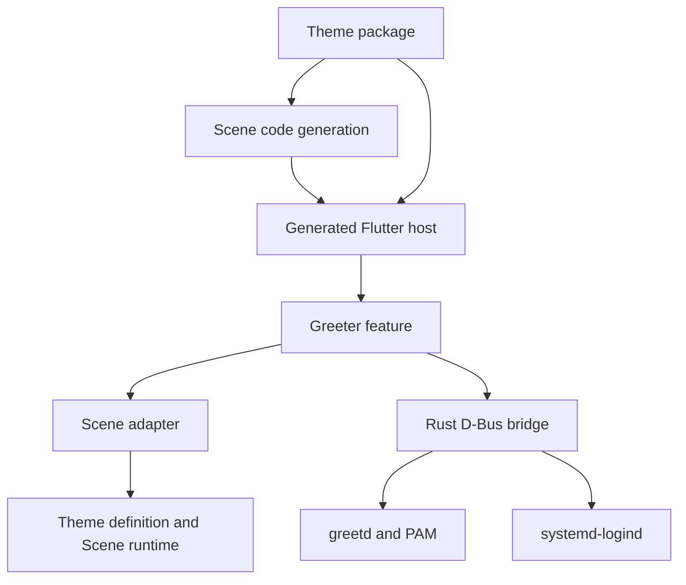

## Ownership boundaries

| Layer | Owner | Responsibilities |
| --- | --- | --- |
| **Build boundary** | Theme package + CLI (`tool/`) | A theme package owns its `*.scene.json`, visual tokens, assets, and widgets. The CLI selects one theme, generates `*.scene.g.dart`, and creates a compiled Flutter host importing that theme's builder. |
| **Frontend boundary** | Flutter app + `greeter_ui` + `scene` | `GreeterFeature` owns business state, credential controllers, and typed commands. `GreeterSceneAdapter` projects semantic state into predicates (`ScenePredicate`) and `GreeterHost` slots. `SceneRuntime` handles normalized layout, 2.5D transforms, and enter/exit animations. |
| **Backend boundary** | Rust bridge (`backend/`) | Owns the `greetd` Unix socket, PAM conversation, attempt tokens (`attempt_id`), session catalog validation, and `systemd-logind` power actions. Exposes the [D-Bus contract](../reference/dbus.md) over a private session bus. |

:::note
Themes never communicate with `greetd`, PAM, or D-Bus directly. They render display-safe state from `GreeterHost` and invoke semantic callbacks.
:::

## Where to go next

- [Code map](code-map.md): Locate every package, runner, and tool in the repository.
- [Frontend architecture](frontend.md): Understand how `GreeterFeature`, `ThemeDefinition`, and `SceneRuntime` cooperate.
- [Backend code guide](backend.md): Explore the Rust authentication actor and session launcher.
