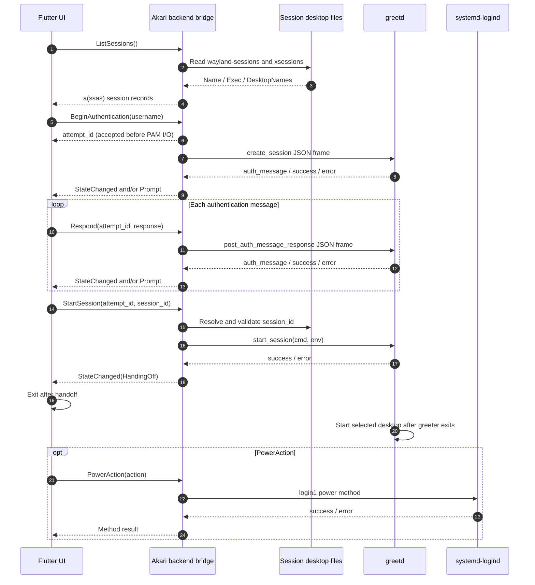
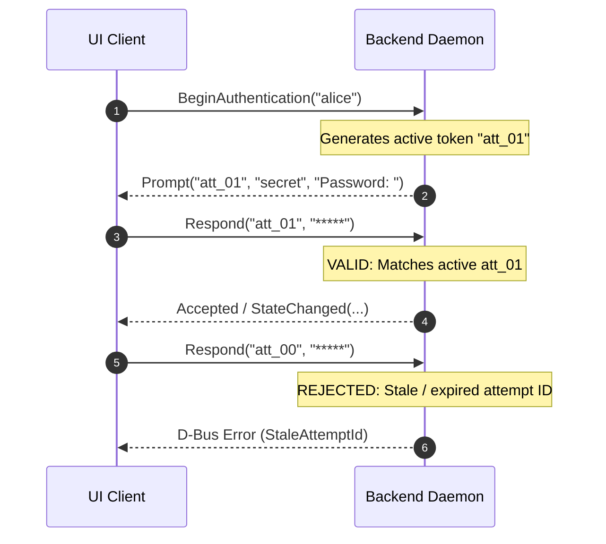
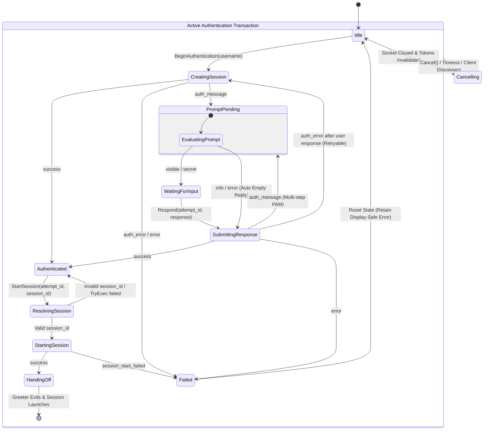

This specification defines the inter-process communication (IPC) contract, transaction invariants, state machine, and security boundaries between the Flutter UI client and the Rust backend daemon.

## 1. Architecture & communication flow

The backend bridge decouples the unprivileged Flutter UI from `greetd` and `systemd-logind`:

```text
┌───────────────────────────────────────────────────────────┐
│                    Flutter UI Client                      │
│            (Unprivileged / Non-root User)                 │
└─────────────────────────────┬─────────────────────────────┘
                              │
                              │ Private / Session D-Bus
                              │ Bus: io.akari.Greeter
                              │ Interface: io.akari.Greeter1
                              ▼
┌───────────────────────────────────────────────────────────┐
│              Akari Backend Bridge Daemon                 │
│         (Translates D-Bus Calls to greetd / System)       │
└──────────────┬─────────────────────────────┬──────────────┘
               │                             │
               │ Unix Domain Socket          │ System D-Bus
               │ 32-bit native-endian        │ (org.freedesktop.login1)
               │ length + UTF-8 JSON         │
               ▼                             ▼
┌─────────────────────────────┐   ┌─────────────────────────┐
│           greetd            │   │     systemd-logind      │
│   (PAM Authentication)      │   │   (Power Management)    │
└─────────────────────────────┘   └─────────────────────────┘
```

### Runtime sequence



### Factor-agnostic PAM handling

- **Multi-step & multi-factor**: A single authentication attempt may emit multiple `visible`, `secret`, `info`, or `error` prompts (passwords, biometrics, OTP, or smart cards).
- **Automatic vs. interactive prompts**: For `info` and `error` messages, the backend emits `Prompt` for display and automatically replies to `greetd` with an empty response. For `visible` and `secret` messages, it waits for `Respond()`.
- **Single-actor concurrency**: One actor serializes all state-changing authentication commands (`BeginAuthentication`, `Respond`, `Cancel`, `StartSession`), while `GetState()` reads a lock-free `watch` snapshot.

## 2. Interface specification: `io.akari.Greeter1`

- **Bus Name**: `io.akari.Greeter`
- **Object Path**: `/io/akari/Greeter`
- **Interface**: `io.akari.Greeter1`

### Methods

| Method | Signature | Description |
| --- | --- | --- |
| `GetState()` | `() -> (s state, s detail)` | Returns the current `AuthState` phase and display-safe status/error text. |
| `ListUsers()` | `() -> a(sss)` | Returns interactive system accounts as `(username, display_name, icon_path)`. |
| `ListSessions()` | `() -> a(ssas)` | Parses `/usr/share/wayland-sessions` and `/usr/share/xsessions` into `(session_id, name, desktop_names)`. |
| `BeginAuthentication(username)` | `(s) -> s attempt_id` | Starts a PAM transaction for `username` and returns a unique `attempt_id` before waiting for PAM I/O. |
| `Respond(attempt_id, response)` | `(ss) -> ()` | Submits user input for an active `WaitingForInput` prompt; zeroes out plaintext memory after socket write. |
| `Cancel(attempt_id)` | `(s) -> ()` | Sends `cancel_session` to `greetd` and resets the state machine to `Idle`. |
| `StartSession(attempt_id, session_id)` | `(ss) -> ()` | Resolves `session_id` against the validated catalog and sends `start_session(cmd, env)` to `greetd`. |
| `PowerAction(action)` | `(s) -> ()` | Executes `PowerOff`, `Reboot`, `Suspend`, or `Hibernate` via `systemd-logind` independently of auth state. |

:::note[`BeginAuthentication` signal ordering]
`BeginAuthentication` returns `attempt_id` immediately upon accepting the command. Clients must subscribe to `Prompt` and `StateChanged` **before** calling `BeginAuthentication` and buffer any signals that arrive before the method reply.
:::

### Session catalog model

Each `ListSessions()` entry maps to a validated `.desktop` file:

| Internal field | Exposed to UI? | Meaning |
| --- | --- | --- |
| `session_id` | Yes | Stable identifier (e.g., `"wayland:sway"`), distinct from `desktop_names` |
| `name` | Yes | User-facing `Name=` from the `.desktop` entry |
| `desktop_names` | Yes | `DesktopNames=` split on `;` in declared order (e.g., `["sway", "wlroots"]`) |
| `session_type` | No | `"wayland"` or `"x11"` |
| `exec` | No | Sanitized `Exec=` argument vector owned strictly by the backend |
| `available` | No | Whether `TryExec` and executable checks pass |

:::caution
The UI only passes `session_id` to `StartSession()`. It can never supply raw `Exec` strings or arbitrary environment maps.
:::

### Signals

| Signal | Signature | Description |
| --- | --- | --- |
| `Prompt` | `(s attempt_id, s prompt_kind, s text)` | Emitted when PAM sends a prompt (`prompt_kind`: `visible`, `secret`, `info`, or `error`). |
| `StateChanged` | `(s attempt_id, s state, s detail)` | Emitted on `AuthState` transitions with display-safe `detail`. |

## 3. Transaction invariants (`attempt_id`)



1. **Single active transaction**: At most one `attempt_id` is active at any time. Calling `BeginAuthentication` from the owning D-Bus sender cancels the previous attempt and starts a new one.
2. **Caller ownership**: `Respond`, `Cancel`, and `StartSession` require the same D-Bus unique sender that called `BeginAuthentication`. Other callers receive `AccessDenied`. Client disconnect automatically cancels the active attempt.
3. **Stale token rejection**: Any call carrying an expired or unknown `attempt_id` fails immediately without touching `greetd`.

## 4. Security boundaries

- **Zero-trace secrets**: Passwords and PAM responses travel only over the unicast `Respond()` call, are never written to logs or D-Bus signals, and are zeroed out in memory after transmission.
- **Bus & privilege isolation**: UI-to-backend IPC uses a private session bus; `PowerAction` uses the system bus (`org.freedesktop.login1`) governed by Polkit. Both UI and backend run under the unprivileged greeter account.
- **Biometric boundary**: Biometric modules (such as Gaze) run inside PAM. The UI never accesses cameras, fingerprint readers, or biometric templates.

## 5. State machine & transitions



### Retryable vs. terminal authentication errors

- **Retryable `auth_error` (after user input)**: When `greetd` returns `auth_error` after the user submitted a response, the backend keeps the same `attempt_id`, emits a display-only `error` prompt, cancels and recreates the underlying `greetd` session, and emits a fresh prompt so the user can retry seamlessly.
- **Terminal `auth_error` (before user input) or `error`**: If `auth_error` occurs without user input (or on a fatal `error` / socket failure), the backend cancels the `greetd` session, transitions to `Failed`, and returns to `Idle` to prevent infinite automatic retry loops.

### Transition table

| Current state | Event / guard | Next state | Backend action |
| --- | --- | --- | --- |
| `Idle` | `BeginAuthentication(user)` | `CreatingSession` | Generate `attempt_id`, connect to `GREETD_SOCK`, send `create_session`. |
| `CreatingSession` | `auth_message` | `PromptPending` | Emit `Prompt` signal. |
| `CreatingSession` | `success` | `Authenticated` | Keep `greetd` session open; await `StartSession()`. |
| `CreatingSession` | `auth_error` or `error` | `Failed` | Cancel/close socket, invalidate token, record display-safe error. |
| `PromptPending` | `visible` or `secret` | `WaitingForInput` | Wait for `Respond(attempt_id, response)`. |
| `PromptPending` | `info` or `error` | `SubmittingResponse` | Emit `Prompt`; auto-send empty response to `greetd`. |
| `WaitingForInput` | `Respond(attempt_id, resp)` | `SubmittingResponse` | Send `post_auth_message_response`; zero out secret buffer. |
| `SubmittingResponse` | `auth_message` | `PromptPending` | Continue multi-step PAM loop. |
| `SubmittingResponse` | `success` | `Authenticated` | Await `StartSession()`. |
| `SubmittingResponse` | `auth_error` after user input | `CreatingSession` | Emit `error` prompt, restart `greetd` session under the same `attempt_id`. |
| `SubmittingResponse` | `error` | `Failed` | Close socket and invalidate token. |
| `Authenticated` | `StartSession(attempt_id, id)` | `ResolvingSession` | Validate `session_id` against catalog. |
| `ResolvingSession` | Invalid `session_id` | `Authenticated` | Return D-Bus error; allow choosing another session. |
| `ResolvingSession` | Valid `session_id` | `StartingSession` | Send sanitized `start_session(cmd, env)` to `greetd`. |
| `StartingSession` | `success` | `HandingOff` | Emit `StateChanged("HandingOff")`, dispatch reply, and exit greeter. |
| *Any Active State* | `Cancel()`, timeout, or disconnect | `Cancelling` -> `Idle` | Send `cancel_session`, clear buffers, and invalidate token. |

## 6. Mock backend & diagnostics

- **Mock backend**: Built with `cargo run --manifest-path backend/Cargo.toml --features mock` (used automatically by `akari run`). Implements `io.akari.Greeter1` on a private bus (`dbus-run-session`) without PAM or `greetd`, accepting `"password"` for authentication.
- **Structured logging**: Default log level is `info`. Logs correlate `attempt_id`, operation, caller, and state while redacting all PAM prompt bodies and credential responses.
