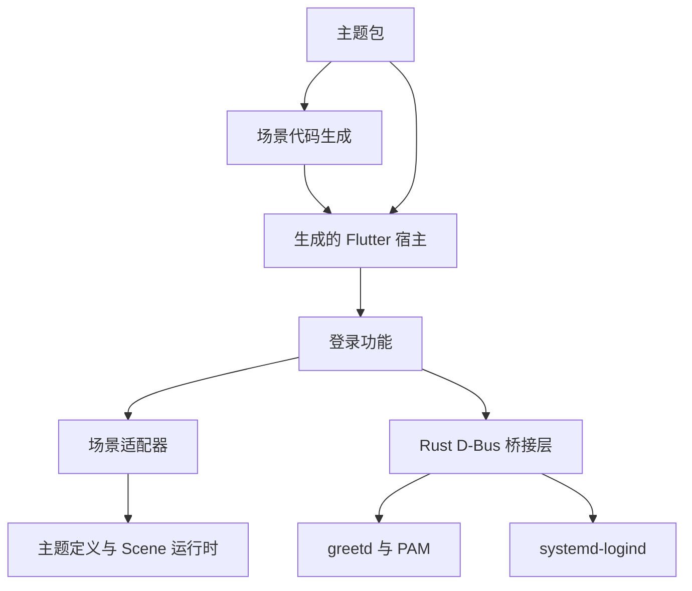

## 职责边界划分

| 层级 | 所属模块 | 核心职责 |
| --- | --- | --- |
| **构建边界** | 主题包 + CLI（`tool/`） | 每个主题包独立维护其 `*.scene.json`、样式配置（Tokens）、本地资源与组件实现。CLI 依据所选主题驱动代码生成（`*.scene.g.dart`），并组装直接导入该主题 Builder 的编译宿主。 |
| **前端边界** | Flutter 应用 + `greeter_ui` + `scene` | `GreeterFeature` 驱动登录业务流、管理凭据控制器并分发类型化命令；`GreeterSceneAdapter` 将认证状态投影为场景谓词（`ScenePredicate`）与数据插槽（Slots）；`SceneRuntime` 负责归一化坐标布局、2.5D 几何变换与节点进出场动效。 |
| **后端边界** | Rust 桥接服务（`backend/`） | 负责与 `greetd` Unix Socket 通信、驱动 PAM 认证流程、维护认证会话生命周期（`attempt_id`）、发现与校验 `.desktop` 桌面环境，并通过 `systemd-logind` 执行电源操作。所有能力均通过私有会话总线上的 [D-Bus 接口规范](../reference/dbus.md) 暴露。 |

:::note
主题包完全与底层的 `greetd`、PAM 及 D-Bus 细节解耦，仅需从 `GreeterHost` 读取安全的展示状态并触发对应的语义操作回调。
:::

## 延伸阅读

- [代码导航](code-map.md)：快速定位仓库中各个模块、运行器与工具脚本的位置。
- [前端架构](frontend.md)：了解 `GreeterFeature`、`ThemeDefinition` 与 `SceneRuntime` 的协作机制。
- [后端代码指南](backend.md)：了解 Rust 认证 Actor 与用户桌面交接流程。
