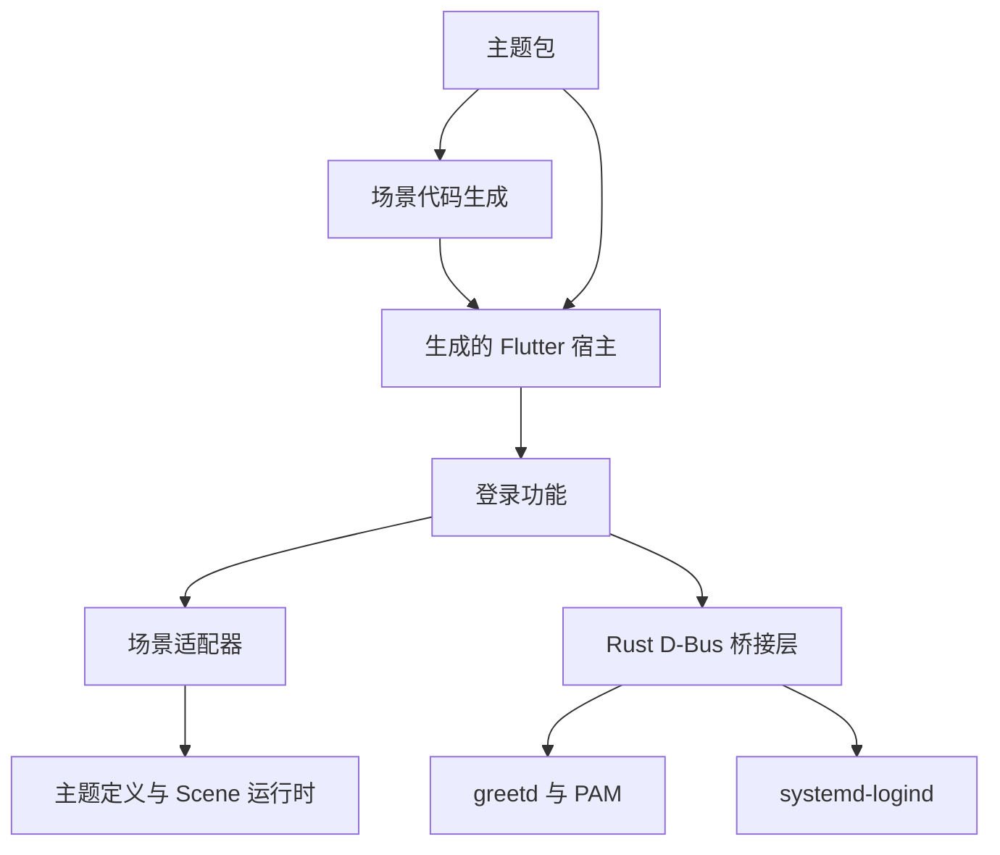

## 职责边界划分

| 层级 | 所属模块 | 核心职责 |
| --- | --- | --- |
| **构建边界** | 主题包 + CLI（`tool/`） | 每个主题包独立管理自己的 `*.scene.json`、样式参数（Tokens）、资源与组件。CLI 根据选定主题生成 `*.scene.g.dart`，并创建直接导入该主题 Builder 的 Flutter 宿主应用。 |
| **前端边界** | Flutter 应用 + `greeter_ui` + `scene` | `GreeterFeature` 管理登录业务状态、凭据控制器与类型化命令；`GreeterSceneAdapter` 将业务状态映射为场景谓词（`ScenePredicate`）与 `GreeterHost` 插槽；`SceneRuntime` 负责归一化布局、2.5D 变换及节点进出场动画。 |
| **后端边界** | Rust 桥接服务（`backend/`） | 管理 `greetd` Unix Socket、PAM 对话、尝试令牌（`attempt_id`）、桌面会话目录校验与 `systemd-logind` 电源操作，通过私有会话总线暴露 [D-Bus 接口约定](../reference/dbus.md)。 |

:::note
主题包不直接与 `greetd`、PAM 或 D-Bus 通信，而是通过 `GreeterHost` 订阅安全显示状态并触发语义回调。
:::

## 延伸阅读

- [代码导航](code-map.md)：快速定位仓库中各个模块、运行器与工具脚本的位置。
- [前端架构](frontend.md)：了解 `GreeterFeature`、`ThemeDefinition` 与 `SceneRuntime` 的协作机制。
- [后端代码指南](backend.md)：了解 Rust 认证 Actor 与用户桌面交接流程。
