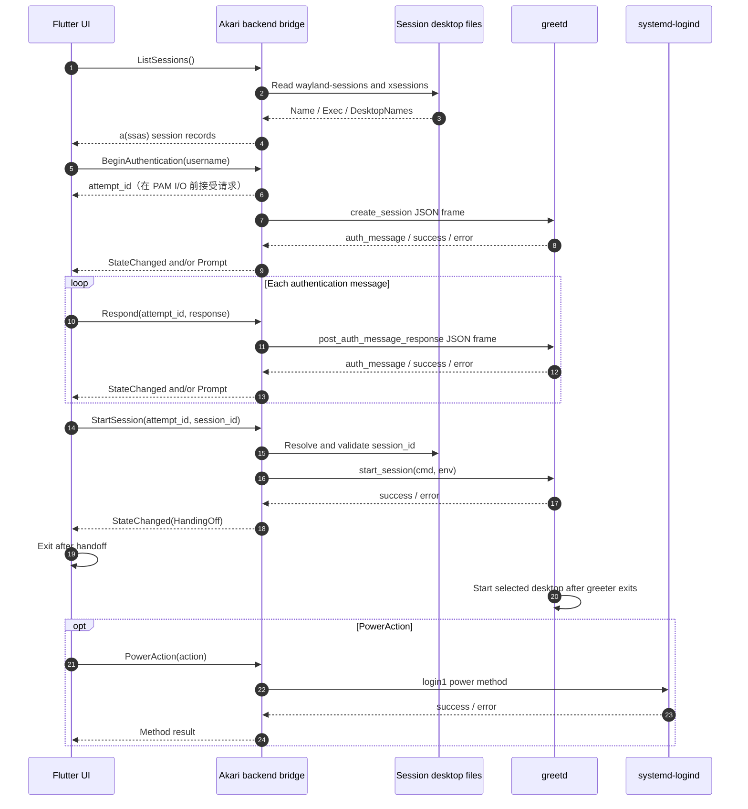
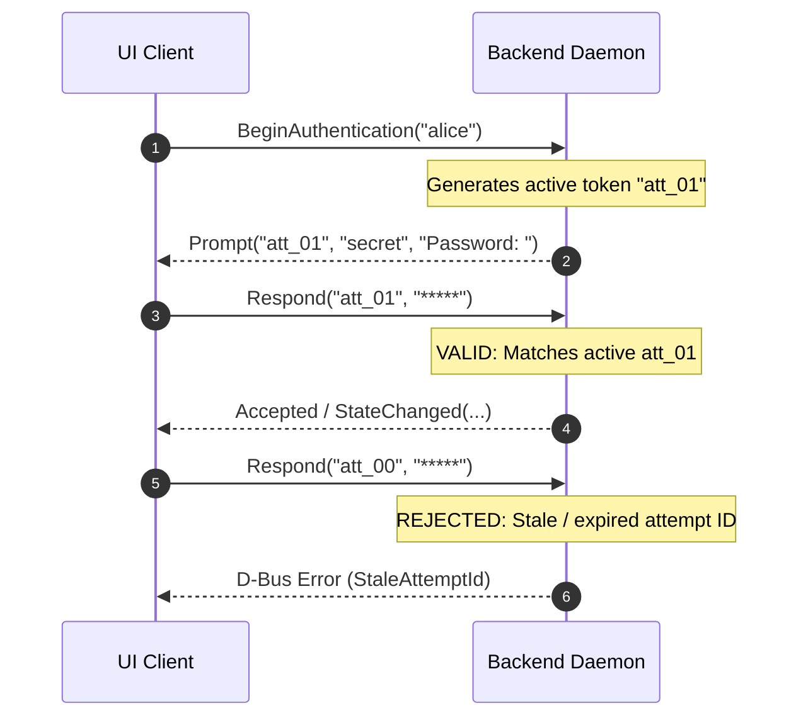
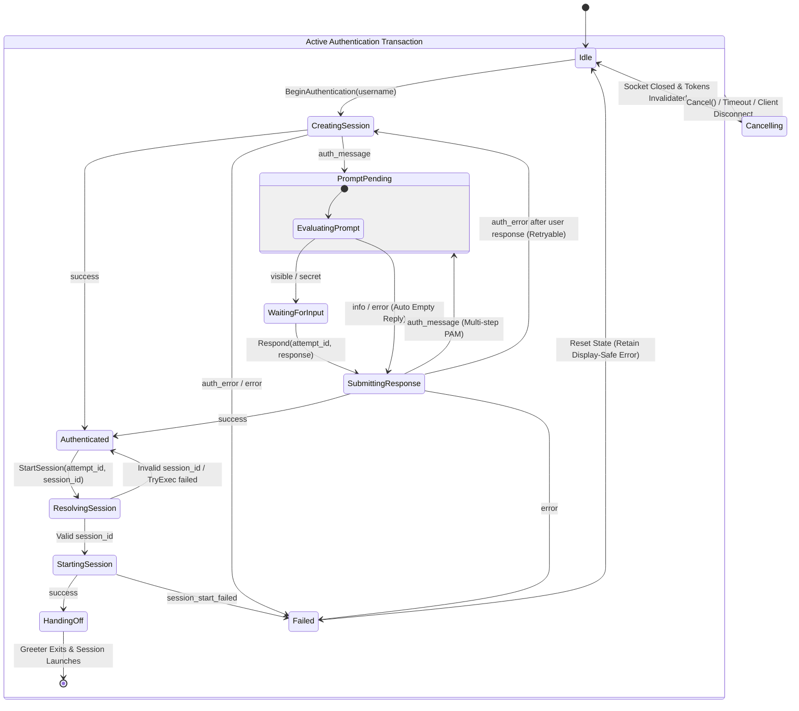

本文定义 Flutter 前端客户端与 Rust 后端守护进程之间的 D-Bus 通信接口、事务不变量、状态机转换规则与安全边界。

## 1. 系统架构与通信流程

系统通过专用、无特权的后端桥接层，将 Flutter UI 与底层系统服务（`greetd` 和 `systemd-logind`）解耦：

```text
┌───────────────────────────────────────────────────────────┐
│                    Flutter UI Client                      │
│            (Unprivileged / Non-root User)                 │
└─────────────────────────────┬─────────────────────────────┘
                              │
                              │ Private / Session D-Bus
                              │ Bus: io.akari.Greeter
                              │ Interface: io.akari.Greeter1
                              ▼
┌───────────────────────────────────────────────────────────┐
│              Akari Backend Bridge Daemon                 │
│         (Translates D-Bus Calls to greetd / System)       │
└──────────────┬─────────────────────────────┬──────────────┘
               │                             │
               │ Unix Domain Socket          │ System D-Bus
               │ 32-bit native-endian        │ (org.freedesktop.login1)
               │ length + UTF-8 JSON         │
               ▼                             ▼
┌─────────────────────────────┐   ┌─────────────────────────┐
│           greetd            │   │     systemd-logind      │
│   (PAM Authentication)      │   │   (Power Management)    │
└─────────────────────────────┘   └─────────────────────────┘
```

### 运行时交互时序



### 与认证因素无关的 PAM 处理模型

- **支持多步与多因子认证**：单次认证尝试可依次发出多个 `visible`、`secret`、`info` 或 `error` 提示（支持密码、人脸、指纹、OTP 或智能卡）。
- **自动确认与交互等待**：收到 `info` 和 `error` 消息时，后端发出 `Prompt` 信号供 UI 展示，并自动向 `greetd` 回复空响应；收到 `visible` 和 `secret` 消息时，则等待 UI 调用 `Respond()`。
- **单 Actor 串行并发模型**：所有会修改认证状态的命令（`BeginAuthentication`、`Respond`、`Cancel`、`StartSession`）由单个 Actor 串行处理；`GetState()` 直接读取无锁 `watch` 快照，不会阻塞底层 I/O。

## 2. 接口规格：`io.akari.Greeter1`

- **总线名（Bus Name）**：`io.akari.Greeter`
- **对象路径（Object Path）**：`/io/akari/Greeter`
- **接口名（Interface）**：`io.akari.Greeter1`

### 方法定义

| 方法 | D-Bus 签名 | 说明 |
| --- | --- | --- |
| `GetState()` | `() -> (s state, s detail)` | 返回当前 `AuthState` 阶段及适合界面展示的状态/错误说明。 |
| `ListUsers()` | `() -> a(sss)` | 返回可登录的系统用户列表：`(username, display_name, icon_path)`。 |
| `ListSessions()` | `() -> a(ssas)` | 解析 `/usr/share/wayland-sessions` 与 `/usr/share/xsessions`，返回 `(session_id, name, desktop_names)`。 |
| `BeginAuthentication(username)` | `(s) -> s attempt_id` | 为 `username` 发起 PAM 认证，并在等待 PAM I/O 前立即返回唯一 `attempt_id`。 |
| `Respond(attempt_id, response)` | `(ss) -> ()` | 为当前 `WaitingForInput` 提示提交凭据，写入 socket 后立即清零内存明文。 |
| `Cancel(attempt_id)` | `(s) -> ()` | 向 `greetd` 发送 `cancel_session`，并将状态机重置为 `Idle`。 |
| `StartSession(attempt_id, session_id)` | `(ss) -> ()` | 在后端目录中校验 `session_id`，并向 `greetd` 发送 `start_session(cmd, env)`。 |
| `PowerAction(action)` | `(s) -> ()` | 独立于认证状态，通过 `systemd-logind` 执行 `PowerOff`、`Reboot`、`Suspend` 或 `Hibernate`。 |

:::note[`BeginAuthentication` 信号时序]
`BeginAuthentication` 在接受命令后立即返回 `attempt_id`。客户端必须在调用该方法**之前**订阅 `Prompt` 和 `StateChanged` 信号，并缓存早于方法回复到达的同一次尝试信号。
:::

### 桌面会话目录模型

`ListSessions()` 返回的每条记录对应一个经过后端校验的 `.desktop` 文件：

| 内部字段 | 是否暴露给 UI | 含义 |
| --- | --- | --- |
| `session_id` | 是 | 稳定会话标识（如 `"wayland:sway"`），与 `desktop_names` 独立区分 |
| `name` | 是 | `.desktop` 中的 `Name=` 显示名称 |
| `desktop_names` | 是 | 按 `;` 切分的 `DesktopNames=` 列表（如 `["sway", "wlroots"]`） |
| `session_type` | 否 | `"wayland"` 或 `"x11"` |
| `exec` | 否 | 经后端解析与校验的 `Exec=` 参数数组（完全由后端持有） |
| `available` | 否 | `TryExec` 及可执行文件检查是否通过 |

:::caution
UI 在调用 `StartSession()` 时只能传入 `session_id`，严禁由前端直接提供任意 `Exec` 命令字符串或环境变量映射。
:::

### 信号定义

| 信号 | D-Bus 签名 | 说明 |
| --- | --- | --- |
| `Prompt` | `(s attempt_id, s prompt_kind, s text)` | PAM 请求输入或展示通知时发出（`prompt_kind`：`visible`、`secret`、`info`、`error`）。 |
| `StateChanged` | `(s attempt_id, s state, s detail)` | `AuthState` 状态转换时发出，`detail` 绝不包含密码或敏感数据。 |

## 3. `attempt_id` 事务规则



1. **单一活动事务**：同一时刻最多存在一个有效 `attempt_id`。同一 D-Bus 调用方再次调用 `BeginAuthentication` 会先取消旧尝试再启动新尝试。
2. **调用方所有权**：`Respond`、`Cancel` 和 `StartSession` 必须由发起该尝试的同一 D-Bus unique sender 调用，其他调用方会收到 `AccessDenied`。客户端断开连接时自动取消其活动尝试。
3. **拒绝过期 Token**：携带不匹配或已过期 `attempt_id` 的请求会被立即拒绝，不会转发给 `greetd`。

## 4. 安全策略与边界

- **敏感输入零残留**：密码与 PAM 响应仅通过单播方法 `Respond()` 传输，绝不写入日志或 D-Bus 信号，并在发送后立即清零内存缓冲区。
- **总线与权限隔离**：前后端 IPC 使用私有会话总线；电源操作通过 system D-Bus（`org.freedesktop.login1`）交由 Polkit 授权。前端与后端均以无特权的 `greeter` 账户运行。
- **生物识别边界**：人脸、指纹等生物识别通过 PAM 模块（如 Gaze）接入。Flutter 前端不直接访问摄像头、指纹设备或生物特征模板。

## 5. 状态机与转换规则



### 可重试错误与终止错误

- **用户输入后的 `auth_error`（可重试）**：当用户提交凭据后收到 `auth_error` 时，后端保留当前 `attempt_id`，发出仅供显示的 `error` 提示，自动取消并重建底层 `greetd` 会话，然后发出新提示供用户直接重试。
- **无用户输入的 `auth_error` 或致命 `error`（终止）**：若尚未提交用户输入即发生 `auth_error`（或发生协议/传输 `error`），后端会取消 `greetd` 会话并转入 `Failed` -> `Idle`，防止自动重试耗尽登录尝试次数。

### 状态转换表

| 当前状态 | 事件 / 条件 | 下一状态 | 后端执行操作 |
| --- | --- | --- | --- |
| `Idle` | `BeginAuthentication(user)` | `CreatingSession` | 生成新 `attempt_id`，连接 `GREETD_SOCK` 并发送 `create_session`。 |
| `CreatingSession` | 收到 `auth_message` | `PromptPending` | 解析提示并发出 `Prompt` 信号。 |
| `CreatingSession` | 收到 `success` | `Authenticated` | 保持 `greetd` 连接，等待 `StartSession()`。 |
| `CreatingSession` | 收到 `auth_error` 或 `error` | `Failed` | 取消并关闭 socket，使 token 失效，记录可显示错误。 |
| `PromptPending` | `visible` 或 `secret` | `WaitingForInput` | 等待匹配当前 `attempt_id` 的 `Respond()` 调用。 |
| `PromptPending` | `info` 或 `error` | `SubmittingResponse` | 发出 `Prompt` 信号，并自动向 `greetd` 回复空响应。 |
| `WaitingForInput` | `Respond(attempt_id, resp)` | `SubmittingResponse` | 发送 `post_auth_message_response` 并立即清零明文缓冲。 |
| `SubmittingResponse` | 收到 `auth_message` | `PromptPending` | 继续多步 PAM 认证循环。 |
| `SubmittingResponse` | 收到 `success` | `Authenticated` | 转入已认证状态，等待 `StartSession()`。 |
| `SubmittingResponse` | 用户输入后收到 `auth_error` | `CreatingSession` | 发出 `error` 提示，在同一 `attempt_id` 下重建 `greetd` 会话供重试。 |
| `SubmittingResponse` | 收到 `error` | `Failed` | 关闭 socket 并使 token 失效。 |
| `Authenticated` | `StartSession(attempt_id, id)` | `ResolvingSession` | 在内部会话目录中校验 `session_id`。 |
| `ResolvingSession` | `session_id` 无效或不可用 | `Authenticated` | 返回 D-Bus 错误，保留已认证状态以便重选。 |
| `ResolvingSession` | `session_id` 有效 | `StartingSession` | 向 `greetd` 发送校验后的 `start_session(cmd, env)`。 |
| `StartingSession` | 收到 `success` | `HandingOff` | 发出 `StateChanged("HandingOff")`，确认方法回复后退出登录界面。 |
| *任意活动状态* | `Cancel()`、超时或客户端断开 | `Cancelling` -> `Idle` | 发送 `cancel_session`，清理缓冲区并使 token 失效。 |

## 6. 模拟后端与日志诊断

- **模拟后端（Mock Backend）**：使用 `cargo run --manifest-path backend/Cargo.toml --features mock` 构建（`akari run` 默认使用）。在隔离的 `dbus-run-session` 中实现完整的 `io.akari.Greeter1` 接口，输入密码 `"password"` 即可模拟认证通过。
- **结构化诊断日志**：默认日志级别为 `info`，通过 `attempt_id`、操作名、调用方与状态串联完整认证链路，同时严格过滤所有 PAM 提示正文与用户输入内容。
